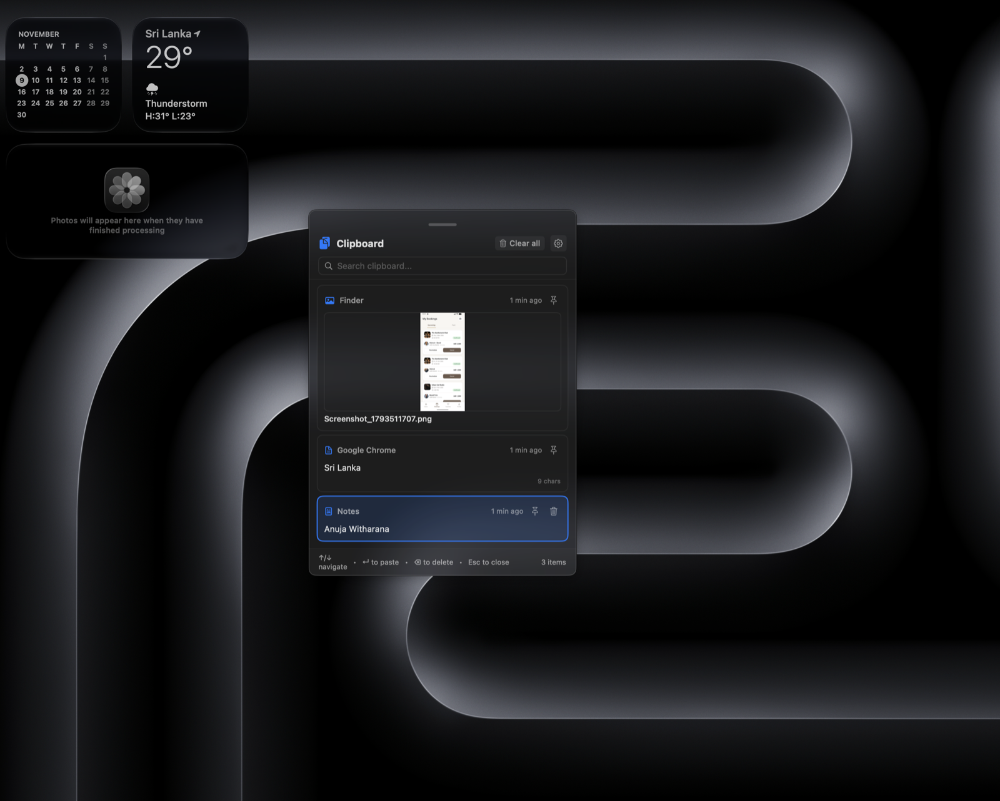
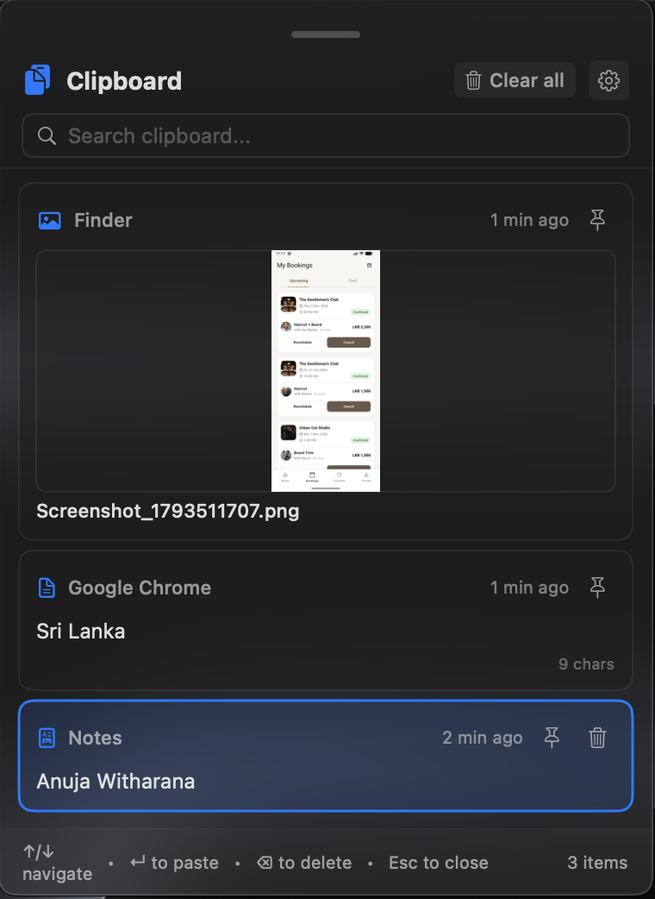
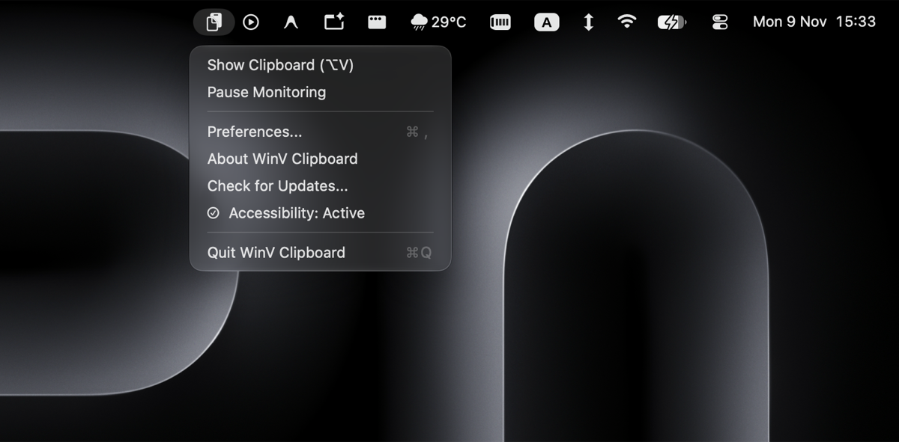
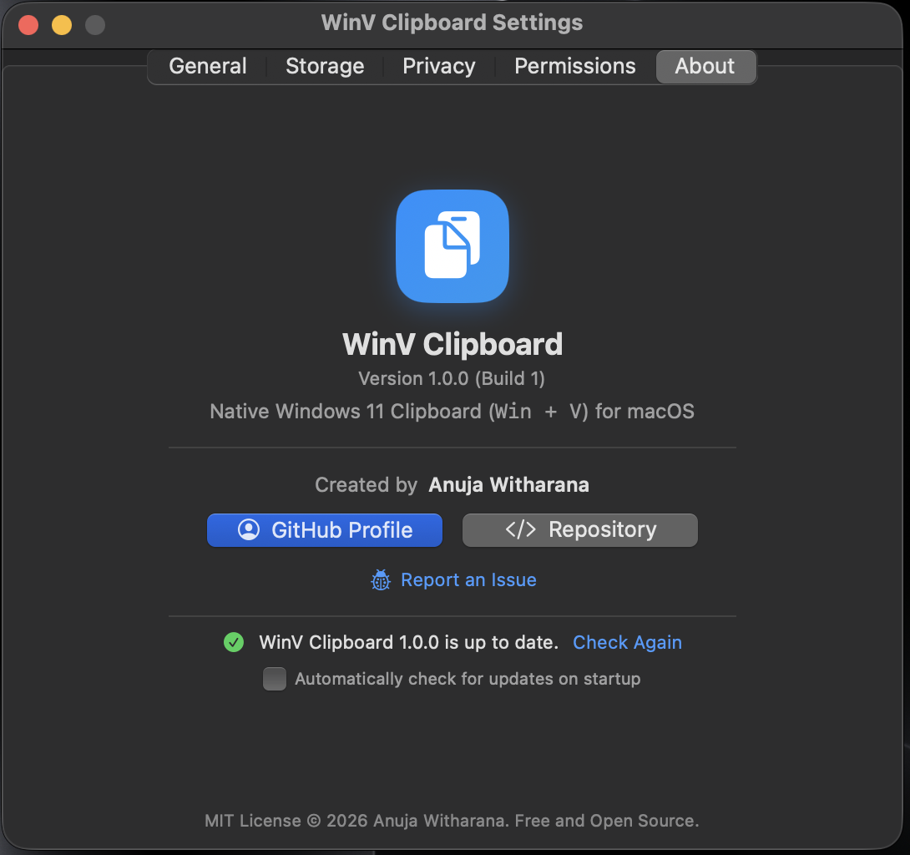
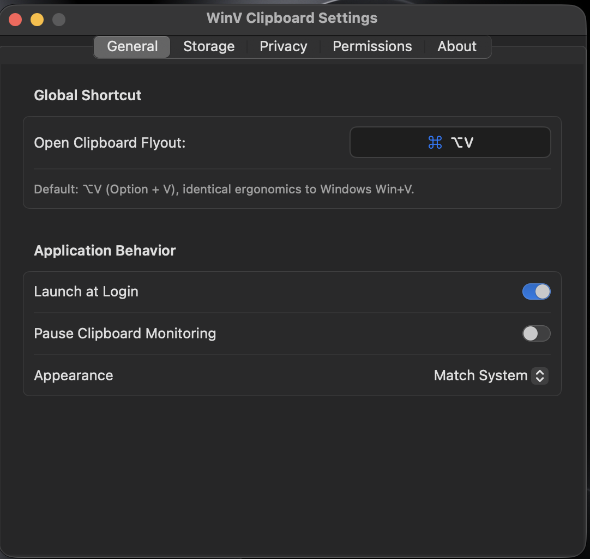
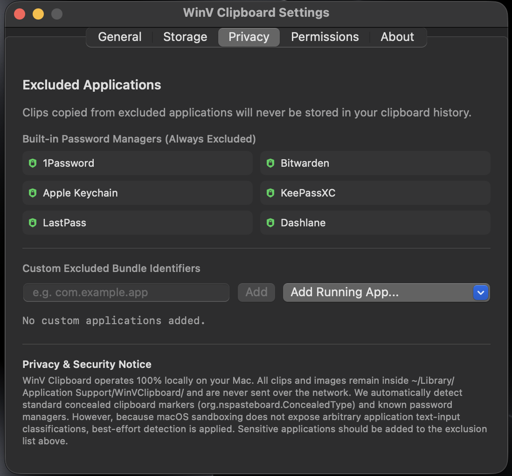
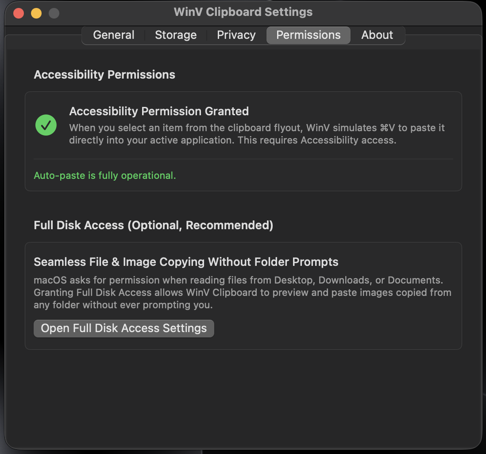

# WinV Clipboard for macOS

<p align="center">
  <strong>The fluid, native Windows 11 Clipboard History experience (`Win + V`) brought to macOS.</strong>
</p>

<p align="center">
  
  
  
  
  <a href="https://github.com/anujawitharana/clipbaord-for-mac/actions/workflows/ci.yml"></a>
</p>

---

## Introduction

If you frequently switch between Windows and macOS, or simply miss the ergonomics of Windows 11's clipboard flyout (`Win + V`), **WinV Clipboard** provides the exact same workflow as a fast, native macOS utility.

Built with **Swift**, **AppKit**, and **SwiftUI**, WinV Clipboard runs quietly in your menu bar (`LSUIElement = true`). When you invoke your hotkey, a translucent acrylic flyout appears right beside your cursor or active text caret, allowing you to search, pin, and paste previously copied clips with a single keystroke or click.

---

## Screenshots

<p align="center">
  
</p>

### Clipboard Flyout & Menu Bar Tray

<p align="center">
  
  &nbsp;&nbsp;&nbsp;&nbsp;
  
</p>

### Settings & Preferences

<p align="center">
  
  &nbsp;&nbsp;&nbsp;&nbsp;
  
</p>

<p align="center">
  
  &nbsp;&nbsp;&nbsp;&nbsp;
  
</p>

---

## Key Features

- **Windows 11 Acrylic Flyout**: Translucent `.ultraThinMaterial` card interface with native rounded corners, border accents, and dynamic Light/Dark mode support.
- **Draggable Anywhere**: Move the flyout across your screens effortlessly by grabbing the top handle or header.
- **Smart Caret & Cursor Positioning**: Anchors directly below the active text insertion caret using macOS Accessibility APIs; seamlessly falls back to the mouse cursor position or screen center.
- **Direct Auto-Paste**: Clicking an item or pressing `Enter` restores focus to your active application and simulates `⌘V` (Command + V).
- **Configurable Global Shortcut**: Defaults to **`⌥V` (Option + V)**. Features an in-app shortcut recorder with system conflict detection (e.g., preventing clashes with system `⌘C`/`⌘V`).
- **High-Performance Storage (SQLite + Disk)**: Metadata and text are stored locally in an indexed SQLite database running in **WAL (Write-Ahead Logging)** mode. Binary images and downsampled thumbnails are managed on the filesystem.
- **Asynchronous & Non-Blocking**: Zero main thread hitching during scrolling. Thumbnails and images decode asynchronously with an in-memory cache.
- **Pinning & History Pruning**: Pin critical items so they survive "Clear all" and history size limits. Automatically prunes unpinned items beyond your configured threshold (default: 50 items).
- **Rich Content Support**: Plain text, Rich Text (RTF), HTML snippets, Web URLs, File URLs, and visual bitmap images (PNG, JPEG, TIFF, HEIC, WebP).
- **In-App GitHub Updates**: 1-click update checks directly against GitHub Releases with auto-download and relaunch, eliminating the need to visit the website or manually reinstall.
- **Privacy & Password Manager Protection**: Automatic detection of concealed types and built-in exclusion of major password managers.

---

## Keyboard Shortcuts

| Shortcut | Action |
| :--- | :--- |
| **`⌥V`** (Option + V) | Toggle the clipboard flyout (customizable in Preferences) |
| **`↑` / `↓`** | Navigate through clipboard items |
| **`↵`** (Enter / Return) | Paste the selected item into the frontmost app |
| **`⌫`** (Delete / Backspace) | Delete the selected item (when not editing search query) |
| **`⌘F`** | Focus the search input field |
| **`⎋`** (Escape) | Dismiss the flyout |

---

## Technology Stack

* **Language**: Swift 5.10+
* **UI Framework**: SwiftUI + AppKit (`NSPanel`, `NSHostingView`)
* **Global Hotkeys**: Carbon Event Manager (`RegisterEventHotKey`, `InstallEventHandler`)
* **Database**: SQLite3 C-API (WAL mode, transactions, `SQLITE_TRANSIENT` memory safety)
* **Keystroke Simulation**: CoreGraphics Event Taps (`CGEvent`)
* **Positioning**: macOS Accessibility API (`AXUIElement`) + CoreGraphics
* **Login Management**: macOS ServiceManagement (`SMAppService`)

---

## Requirements

* **Operating System**: macOS 14.0 (Sonoma) or newer.
* **Architecture**: Apple Silicon (M1/M2/M3/M4) or Intel 64-bit.

---

## Installation & Build Instructions

### Option 1: Download Release
1. Download `WinVClipboard.app.zip` from the [Releases](https://github.com/anujawitharana/clipbaord-for-mac/releases) page.
2. Unzip and drag `WinVClipboard.app` into your `/Applications` folder.
3. Launch the application from Applications or Spotlight.

### Option 2: Build from Source
Ensure you have Xcode 15+ or the Swift command-line tools installed:

```bash
# Clone the repository
git clone https://github.com/anujawitharana/clipbaord-for-mac.git
cd clipbaord-for-mac

# Run automated tests
swift test

# Build and package the release application bundle
./Scripts/build_app.sh
```

The script compiles a production release binary and outputs a standalone, code-signed application bundle:
```bash
open WinVClipboard.app
```

---

## Accessibility & System Permissions

### 1. Accessibility (Required for Auto-Paste)
When you select an item from the flyout, WinV Clipboard switches focus to your target application and synthesizes a `⌘V` keystroke. This requires macOS Accessibility access:
1. Open **System Settings** → **Privacy & Security** → **Accessibility**.
2. Toggle on **WinV Clipboard**.
3. Alternatively, click the indicator under **WinV Preferences → Permissions** to open the system prompt directly.

*Note: If Accessibility is not enabled, selecting an item copies it to your clipboard so you can paste manually.*

### 2. Full Disk Access (Optional, Recommended)
macOS Sonoma and Sequoia protect user folders (`Desktop`, `Downloads`, `Documents`) with Transparency, Consent, and Control (TCC). Granting Full Disk Access enables WinV Clipboard to preview and paste images copied from any folder without intermittent system permission prompts:
* Open **System Settings** → **Privacy & Security** → **Full Disk Access**, and add **WinV Clipboard**.

---

## Privacy & Offline Storage Architecture

WinV Clipboard is built with a **strict offline-first, privacy-by-design** architecture:

* **Zero Network Calls**: WinV Clipboard contains no analytics, no telemetry, no crash-reporting SDKs, and no network dependencies.
* **100% Local Storage**: All clipboard content remains on your Mac under:
  ```
  ~/Library/Application Support/WinVClipboard/
  ├── clipboard.db          # SQLite database containing metadata and text
  ├── images/               # High-resolution image content
  └── thumbnails/           # 300px downsampled cache for instant rendering
  ```
* **Concealed Content Filtering**: Automatically detects and ignores sensitive pasteboard types:
  * `org.nspasteboard.ConcealedType`
  * `org.nspasteboard.AutoGeneratedType`
  * `org.nspasteboard.TransientType`
  * `com.agilebits.onepassword`
  * `PasswordPboardType`
  * `com.apple.findmy.clipboard`
* **Default Password Manager Exclusions**: Clips copied from the following bundle identifiers are never captured:
  * 1Password, Bitwarden, Apple Keychain Access, KeePassXC, LastPass, Dashlane, Enpass, NordPass.
* **Custom Exclusion Blacklist**: Add any sensitive applications directly in Preferences.
* **Pause Monitoring**: Toggle clipboard recording off at any time from the menu bar icon.

---

## Known Limitations

1. **Keyboard Layout Localization**: The global hotkey engine currently maps ANSI hardware keycodes. On non-QWERTY layouts (such as French AZERTY or German QWERTZ), `⌥V` maps to the physical key position rather than the localized character key.
2. **Third-Party Caret Detection**: Certain cross-platform or custom-rendered text editors (such as Java Swing or older non-standard WebViews) do not publish `kAXSelectedTextRangeAttribute` via macOS Accessibility. WinV Clipboard automatically falls back to your mouse cursor position in these applications.

---

## Roadmap

- [ ] Support localized keyboard layout translation via `TISCopyCurrentKeyboardInputSource` and `UCKeyTranslate`.
- [ ] In-panel toast alerts when Accessibility permissions are pending.
- [ ] SQLite Full-Text Search (FTS5) for faster indexing of large histories.
- [ ] Export and import clipboard history (JSON / encrypted backup).
- [ ] Custom sound effects and haptic feedback.

---

## Contributing

Contributions are welcome! Please read [CONTRIBUTING.md](CONTRIBUTING.md) for details on code style, testing, and pull request procedures.

---

## License

This project is licensed under the MIT License - see the [LICENSE](LICENSE) file for details.

Copyright (c) 2026 Anuja Witharana.
